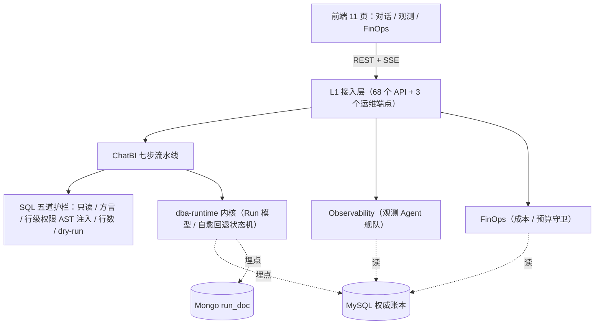

# dba-platform

**数据大屏 × 多 Agent 平台**：用自然语言生成数据大屏，并对「生成过程本身」做治理。

一个 **uv workspace** 单体仓库，围绕同一个运行时内核构建三大模块：

| 模块 | 一句话职责 |
|---|---|
| **ChatBI** | 「问一句 → 出一屏」：七步流水线 + 五道 SQL 护栏 |
| **Observability** | 观测 Agent 舰队自身：指标 / 拓扑 / 异常 / 静默失败 |
| **FinOps** | 成本计量、预算守卫、复用率优化 |

---

## 核心设计

1. **一个 `trace_id` 三视角**：一次提问（Run）贯穿全程——ChatBI 看它是执行记录、Observability 看它是观测对象、FinOps 看它是计量对象。**埋点只做一次**，三模块是同一份运行时数据的三个视角。
2. **行级权限生成期下沉**：权限在 SQL **生成阶段**就注入 `WHERE` 条件，不做「查完再过滤」——否则敏感数据已进过内存 / 日志 / LLM 上下文。护栏用 AST（sqlglot）+ 合取项覆盖性断言，fail-closed。
3. **预算守卫前置**：LLM 调用**前** `reserve → settle/release` 三段式，软限降级、硬限熔断，且**硬熔断默认关闭**（唯一会中断业务的动作，避免误配全熔断）。

---

## 项目结构

```
packages/agent-runtime    # L2 可复用运行时内核：Pipeline / RunContext / 埋点 / Protocol
apps/platform             # L1 平台应用（FastAPI + 三模块 + L4 能力 + L5 存储）
  └─ src/dba/
      ├─ api/             #   L1 接入层：路由 / 中间件 / 依赖注入 / 统一错误体
      ├─ modules/         #   L3 领域层：chatbi / observability / finops
      ├─ capabilities/    #   L4 能力层：budget / cost / embedding / memory / messaging
      │                   #              routing / semantics / skills / telemetry
      ├─ storage/         #   L5 存储层：es / milvus / minio / mongo / mysql / redis
      └─ schemas/         #   大屏 JSON 与 DTO schema
apps/worker               # 常驻定时任务（rollup / 异常扫描 / 对账 / 分区 / 归档）
frontend/                 # React 18 + Vite 7 前端（登录 + 对话 + 观测 5 页 + FinOps 4 页）
migrations/               # Alembic（0001 建表 / 0002 outbox / 0003 性能索引）
deploy/                   # Dockerfile + embedding_server.py（本地 bge-m3 向量服务）
scripts/seed.py           # 造数（dba seed 的唯一实现）
docs/                     # PRD / 需求 / 代码设计文档
var/                      # 运行时数据目录（DLQ 落盘等，不入库）
```

---

## 技术栈

| 层 | 选型 |
|---|---|
| 后端 | FastAPI · SQLAlchemy(asyncio) + asyncmy · motor · redis · pymilvus · elasticsearch · minio · openai/anthropic |
| 前端 | React 18 · Vite 7 · TypeScript · ECharts（按需注册）· TanStack Query · Zustand |
| 工具链 | uv（workspace）· Python ≥ 3.12 · npm |

---

## 快速开始

> ★ 外部组件（MySQL / MongoDB / Redis / Milvus / Elasticsearch / MinIO / Embedding）
> 部署在**虚拟机 `192.168.200.10`**，本机不拉容器。连接凭据见 `.env`。

```bash
uv sync --all-packages --extra prod          # 安装（含全量存储驱动）
cp .env.example .env                         # 按需覆盖为真实凭据
uv run dba migrate                           # Alembic 升级 MySQL（幂等）
uv run dba bootstrap-storage                 # 建 Milvus / ES / MinIO 资源
uv run dba seed --demo                       # 灌入口径 / 技能 / 价格表 / 演示数据
uv run uvicorn dba.main:app --port 8000      # 启动后端
```

前端：

```bash
cd frontend && npm install && npm run dev    # Vite dev server（默认 5173）
```

若本机没有 `uv`，可改用虚拟环境直连：`.venv/Scripts/python.exe -m dba.cli <子命令>`、
`.venv/Scripts/python.exe -m uvicorn dba.main:app --port 8000`。

### 演示账号

| 账号 | 口令 | 说明 |
|---|---|---|
| `admin` | `admin123` | 管理员（可改语义层 / 预算 / 护栏策略） |
| `analyst1` | `analyst123` | 业务线 1 的分析师 |

`dba seed --demo` 会创建演示事实表 `fact_sales`（45 天数据，含省份 / 品类 / 渠道维度），
口径与字段映射登记为 `sem_metric` / `sem_field_mapping`，因此问答链路可直接跑通。

---

## 架构



分层边界：L1 接入 `api/` · L2 内核 `packages/agent-runtime` · L3 领域 `modules/` ·
L4 能力 `capabilities/` · L5 存储 `storage/`。**L3 模块之间不互相 import**，跨模块协作只能经
L4 能力层或 `trace_id` 软关联（例如 FinOps 的成本时序必须经 `ObservabilityService.timeseries` 读）。

### ChatBI 七步流水线

`intent` → `schema_link` → `sql_gen` → `sql_guard` → `sql_exec` → `visual` → `narrator`。
失败时 `sql_gen` 可自愈重生成（带失败 SQL 与校验反馈）；**越权类错误短路不重试**。

五道护栏全部 **fail-closed**：
`readonly`（单语句 + 只读 + 危险构造黑名单 + 表/函数白名单）→ `dialect`（方言往返）→
`row_scope`（AST 按 SELECT 作用域注入行级谓词）→ `row_scope_verify`（顶层 AND 链合取项断言）→
`limit`（行数上限 + `MAX_EXECUTION_TIME`）→ `dry_run`（只读账号 `EXPLAIN` 预执行）。

### Observability

四角色线性流水线 `collect → aggregate → anomaly → broadcast`；**无阈值**异常检测
（EWMA 基线 `α=0.3` + MAD 稳健偏差 `k=3.5`）与静默失败检测；三条价值指标
（技能复用率 / 死技能 / 记忆命中率）；指标 rollup 幂等；调用拓扑；OTLP 接入外部 Agent。

### FinOps

四角色线性流水线 `meter → attribute → guard → optimize`；成本是**派生量**
（明细固化 token 与 `price_book_id`，价格表修正后可精确重算）；四维归因
（业务线 / Agent / 模型 / 技能）；预算 `reserve → settle/release` 三段式（Redis Lua 原子
+ MySQL 权威账本，幂等）；降级动作可开关，**硬熔断默认关闭**并带豁免线与 `kill_switch`；
死循环检测（300s 内同工具同参数 ≥ 8 次）；复用率-成本曲线带对照组。

### 前端页面

登录页 + 对话页（七步进度 / SQL 折叠 / 逐面板出图 / 流式解说）+ 观测 5 页
（总览 / 拓扑 / Runs / Run 详情 / 异常）+ FinOps 4 页（成本总览 / 预算与护栏 / 复用率 / 优化建议）。

---

## 接口速览

- **REST**：`/api/v1` 下 68 个端点，分组为 `auth`(6) · `chat`(9) · `dashboards`(4) ·
  `semantics`(6) · `obs`(19) · `finops`(22) · `stream`(2)。
- **运维端点**：`/health`（存活，不查依赖）· `/ready`（逐组件 + `metering_bound`，三态
  `ok`/`degraded`/`not_ready`）· `/metrics`（Prometheus 文本）。
- **SSE**：提问后先用 `POST /chat/stream-ticket` 换一次性票据，再以 `?ticket=` 订阅
  `GET /stream/runs/{trace_id}`；服务端每条消息写 `id: {seq}` 支持断线续传，回放最近 200 条
  （TTL 1h），历史被截断时显式下发 `replay.gap`，心跳 15s，单次订阅上限 300s。
- **统一错误体**：`{"code","message","detail","trace_id"}`；响应头回写 `X-Trace-Id`。

---

## 命令行（`dba`）

```bash
dba migrate [--revision head] [--dry-run]   # Alembic 升级 MySQL（幂等）
dba bootstrap-storage [--only milvus|es|minio]  # 建 Milvus collection / ES index / MinIO bucket
dba seed [--demo]                           # 灌入口径 / 技能模板 / 价格表 / 预算 / 演示数据
dba reindex [--target all|milvus|es]        # 重建检索索引（由 worker job 落地）
```

worker 常驻进程（`dba-worker`）注册 8 个周期任务：`rollup`(02:00) · `partition`(每月 1 日) ·
`anomaly_scan`(每 15 分钟) · `report`(07:00) · `reconcile`(03:00) · `stale_run`(每 10 分钟) ·
`semcache_gc`(每 30 分钟) · `archive`(每周日)，均带 Redis 分布式锁与 RunContext。

---

## 配置

环境变量前缀统一 `DBA_`，由 `pydantic-settings` 读取 `.env`，并按 `DBA_ENV` 叠加 `.env.{env}`。
完整清单见 `.env.example`，常用项：

| 项 | 默认 | 说明 |
|---|---|---|
| `DBA_CHATBI_MAX_ROWS` | 5000 | 单次查询行数上限（超限截断） |
| `DBA_CHATBI_SQL_TIMEOUT_S` | 30 | SQL 执行超时（SQL 提示 + 应用侧双保险） |
| `DBA_CHATBI_INLINE_ROW_THRESHOLD` | 500 | 超过则走 MinIO 预签名 URL，不内联 |
| `DBA_GUARDRAIL_ALLOW_CIRCUIT_BREAK` | false | 硬熔断开关（唯一会中断业务的动作） |
| `DBA_GUARDRAIL_DEGRADE_POLICY` | fail_open_mysql | Redis 不可用时走 MySQL 行锁兜底 |
| `DBA_RUN_DEADLINE_S` | 180 | 单次 Run 墙钟预算 |

### 接真实模型

默认走确定性演示替身（`DemoLLMClient`），追问同一问题结果稳定。要让大屏真正随问题变化：

```bash
# .env
DBA_ENV=dev
DBA_LLM_PROVIDER=deepseek
DBA_LLM_BASE_URL=https://api.deepseek.com/v1   # ★ 只到 /v1，SDK 会自行追加 /chat/completions
DBA_LLM_API_KEY=sk-xxx
DBA_LLM_ALLOW_DEV=true                          # ★ dev 默认走替身，置 true 才用真实模型
DBA_LLM_MODEL_PREMIUM=deepseek-chat
DBA_LLM_MODEL_STANDARD=deepseek-chat
DBA_LLM_MODEL_ECONOMY=deepseek-chat
```

**LLM 三态开关（优先级由高到低）**：

1. `DBA_LLM_USE_FAKE=true` → 恒用替身；
2. `DBA_ENV=test` 或 API Key 为空 → 替身；
3. `DBA_ENV=dev` 且未设 `DBA_LLM_ALLOW_DEV=true` → 替身（避免开发期误打付费 API）；
4. 否则 → 真实模型。

> ⚠️ 真实模型依赖**语义层**才知道表结构，请确保已执行 `uv run dba seed --demo`。

---

## 文档

| 文档 | 内容 |
|---|---|
| [产品需求文档](docs/PRD.md) | 产品定位、目标用户、核心功能、业务目标与指标、用户旅程 |
| [需求文档](docs/requirements.md) | 功能需求编号与验收标准、优先级、端到端场景、已实现/未实现/降级项 |
| [代码设计文档](docs/design.md) | 分层架构、归属矩阵、内核与三模块设计、数据模型、接口与 SSE 协议、部署与风险 |

---

## 已知限制

- **无测试与静态检查工具链**：`tests/`、`evals/`、ruff/mypy/pytest/vitest 已从仓库移除，当前仅前端保留 `npm run lint`（`tsc --noEmit`）与 `npm run build`。
- **IM 播报未接真网关**：`BroadcastAgent` 默认注入 `LogBroadcastGateway`（只落结构化日志）。
- **复用率曲线数据源为空态**：`skill_usage` 尚无生产写入方，曲线通常返回空。
- **取消 Run 仅在单副本生效**：取消令牌为进程内结构，跨副本需 Redis 广播。
- **`frontend/src/lib/*.ts` 未被版本控制**：被根 `.gitignore` 的 `lib/` 规则误忽略，新克隆需注意前端构建。
- **Agent 上报鉴权较弱**：`X-Agent-Token` 仅校验非空。

---

## License

见仓库根目录（如未包含许可证文件，默认按内部项目处理）。
